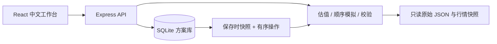

# 投资组合分析与调仓模拟：设计与交付说明

任务：VC-FIN-001 / V3.0。技术栈由 AI 提议，用户同意按方案在本地完成；不上传 GitHub。本文件说明最终实现，开工方案原版保留在 `PLAN.md`，首次本地 Git 提交为 `fa5fb8c`。

## 1. 需求、边界和交互

目标是让评审者用给定的 6 只股票与固定行情，完成资产查看、集中度识别、顺序买卖、原始/模拟对比和命名保存/重开。前端采用中文单页工作台：资产摘要、持仓对比表、行业条形分布和调仓操作面板；“已保存方案”切换到方案列表。用户后续选择纯白＋蓝色的简约方向：摘要采用统一分隔布局，减少渐变和阴影，放大正文与数字，浅蓝色标记调仓后持仓数量发生变化的行。颜色作为辅助，前后数值仍完整保留。没有真实交易或行情预测。

页面进入时独立加载原始组合与方案列表。组合载入中显示状态；连接失败可重新连接。没有操作时显示指引，没有保存方案时显示空状态。表单请求期间禁用提交，避免连续点击。错误在操作或保存区域展示，失败时保留上次成功结果。新建模拟或重开其他方案时，未保存操作需要确认放弃；刷新/关闭页面提供浏览器离开提醒。已保存方案为只读，可回原始组合新建草稿。

原型只支持单用户、单组合、CNY、给定标的和同一固定价格。手续费、税费、分红、融资、卖空、登录、外部 API、模型接入和公网部署不在实现范围内。价格缺失时的后续设计是拒绝估值并指明标的，避免当作零价格；未知行业的后续设计是独立列为“未知行业”，保持分母不变，本次无需额外实现。

用户后续要求增加AI建议与对话，并明确选择先做模拟版，因此增加“AI助手”演示入口：由本地规则生成建议和限定主题回复，页面、消息标签及接口均明确演示模式，未接入真实模型。该扩展不改变核心金融计算与验收口径，也不依赖外部服务。

## 2. 数据、状态与系统结构

`Snapshot` 包含组合 ID、名称、币种、快照 ID/时间、现金、标的价格/行业/数量及规则。`Operation` 仅包含 symbol、side 和正整数 quantity。`Analysis` 为完整持仓估值、现金、总资产、行业分布和提醒；`Simulation` 返回 original、simulated、operations 和 steps。每步包含该步 Analysis、规范化操作及相对于前一步的 impact，第一步的前态为原始组合。前后端通过 `shared/types.ts` 共用响应类型，但运行时校验仍由后端执行。

原始组合从 `data/portfolio.json` 载入，仅作为只读输入。一次模拟深拷贝输入，从初始状态按顺序重放所有操作。前端只在请求成功后替换操作列表和结果；不在浏览器重复计算金融口径。草稿只存在页面内存，刷新后不保留。

后续增加逐步回看：后端每次执行成功操作后立即生成独立分析和影响，提醒变化以 type+key 作为身份比较，不以提醒数量推断。React 仅选择原始结果或某步后端结果，同时更新摘要、持仓、行业、提醒和公式；不修改操作列表。历史视图隐藏交易与保存表单，并提供“回到最新结果”，防止把过去状态误当成可继续交易的草稿。新增、保存、重开成功后自动回到最新结果。解释面板由前端按服务端结构化字段组织文字；计算依据以 details 默认折叠。

SQLite `plans` 表存储 id、name、created_at、snapshot_id、完整原始快照 JSON 和有序操作 JSON；单条 INSERT 原子写入整份方案。保存前重新执行后端校验，忽略客户端伪造的结果。读取时使用保存的原始快照重新计算，因此更换初始化文件不会改变旧方案。没有单独存储易漂移的派生金额。原始文件不会被保存操作覆盖。

生产模式由 Express 同时提供构建后的前端与 `/api`，避免评审时需要启动两个服务；开发模式 Vite 代理 API。服务仅绑定本机 127.0.0.1。数据库自动初始化，无外部服务依赖。

## 3. 接口与异常

| 接口 | 输入 / 输出 | 约束与错误 |
|---|---|---|
| GET `/api/portfolio` | snapshot + analysis | 原始组合完整结果 |
| POST `/api/simulate` | operations → original/simulated/operations | 从原始快照依序重放，一笔失败整次拒绝 |
| POST `/api/plans` | name + operations → 完整方案 | 名称修剪后 1～60 字，后端重算后保存；201 |
| GET `/api/plans` | 方案概要数组 | 创建时间倒序；相同时间按插入顺序倒序 |
| GET `/api/plans/:id` | 完整方案及复算结果 | 使用持久化快照；不存在返回 404 |
| POST `/api/assistant/advice` | context → demo解读/草案/验算结果 | 后端重算上下文，草案经simulate验证，不写库 |
| POST `/api/assistant/chat` | context/question/history → demo回复 | 限定主题，最多6条输入历史，每条及问题不超过1000字符 |

统一错误：`{error:{code,message,operationIndex?}}`。JSON 格式错误 400；请求超 32KB 为 413；业务错误 422（数量非法、标的未知、方向错误、余额不足、持仓不足、超安全整数、方案名或操作数组非法）；方案/地址不存在 404；存储等内部故障 500，不向浏览器泄露内部数据库细节。每个方案最多 100 笔，空操作方案允许保存，可重名，UUID 区分。

断网及无法识别响应由前端统一转为中文提示，保留已成功计算的结果。保存失败不会误显示“已保存”。后端模拟没有可变草稿状态，因此失败没有需要回滚的已生效交易。

## 4. 金额精度、边界与验证

金额由十进制字符串严格解析成整数分；价格乘数量、现金变化和累加都检查非负安全整数。超出 JavaScript 安全整数范围的请求拒绝，避免舍入后继续计算。展示输出再格式化为两位小数的字符串。

占比的判定使用 BigInt 整数交叉相乘：`标的市值分 × 100 > 总资产分 × 30`，行业同理使用 50。比较与展示独立，刚好等于不提醒；显示百分比以整数基点进行四舍五入。“实际 30.004%、展示 30.00%”仍会正确提醒，已有专门测试。

买入减少现金并增加持仓，卖出增加现金并减少当前模拟持仓，后续操作消费前序结果。无费用、固定价的条件保证总资产不变。现金计入总资产，不属于任何行业；卖空禁止，卖完的标的仍在明细中显示数量零，持仓标的数只计正数量。

验证独立使用题目给定的期望数字：初始总资产 100000、现金 20000；卖 A01 100 后现金 30000、A01 30%、科技 50%；再买 A02 100 后现金 25000、A02 500 股、科技 55%。自动化测试还覆盖真实 HTTP、SQLite 关闭重开、快照隔离、伪造结果、非法类型/JSON/大请求与存储写失败；浏览器真实点击、刷新和重启另留截图，详情见 `VERIFY.md`。

## 5. 设计决策与备选方案

| 决策 | 备选 | 选择理由与代价 |
|---|---|---|
| SQLite + Node 内置模块 | JSON 文件、外部数据库 | 单条写入原子、可查列表，无须外部数据库服务；代价是要求 Node.js 24.15+ |
| 保存原始快照 + 操作，重开复算 | 只保存最终结果 / 仅关联当前数据文件 | 保留可追溯的计算输入，防止快照变更使旧方案漂移；代价是每份方案冗余小份快照 |
| 后端唯一业务计算 | 前端乐观计算后再对账 | 避免双份精度/阈值逻辑；代价是添加操作需等待一次本机请求 |
| 少量自写 CSS、表格和条形图 | 完整 UI/图表库 | 六个标的无需复杂图表，减少依赖；窄屏持仓表允许容器内横向滚动 |
| 后端返回逐步结果、影响，前端选择展示 | 前端重算每一步 / 为每次回看另发请求 | 口径保持单一，回看无额外请求；代价为响应体随操作数增长。最多100笔、六标的规模可控，数据库仍只保存输入 |

## 6. 完成情况与复盘

FR-01～FR-05 已实现，AC-01～AC-05 已执行验证。交付含源码、依赖锁文件、初始化数据、运行说明、初始方案、最终设计、验证记录、实际截图及演示提示。范围内未完成项：无；最终结果以 `VERIFY.md` 的实际证据为准。

与初始方案的差异：技术和数据方案保持一致；浏览器 Tabbit 启动器在当前环境无法运行，改用独立 Playwright + 本机 Chrome 采集证据；没有使用用户现有浏览器标签页。实施中发现并修正了 React 测试的 props 类型推导问题，以及网络失败提示的英文原始信息。

已知限制：草稿刷新后不会恢复；仅查看已保存方案；SQLite 文件丢失会导致方案丢失；仅在 Windows/Chrome 实测；不覆盖多人并发场景。若增加一小时，优先补充页面组件交互测试并改善键盘焦点与读屏提示，其次提供显式数据库备份导出。不要扩展真实交易或行情能力。

## 7. AI 协作记录

工具：Codex；参与需求拆解、设计提案、TypeScript/React/Express 实现、测试、截图、文档与独立代理审阅。以下为关键交互摘要，不代表候选人手工完成了所有开发或核验；使用者应实际运行并理解后再提交。

| 片段 | 提供的上下文与完成标准 | AI 产出 | 实际核验与采纳理由 |
|---|---|---|---|
| 需求到设计 | PDF 全文及原始 JSON；限定 FR-01～FR-05、AC-01～AC-05，本地可运行 | PLAN.md、设计提案、React/Express/SQLite 技术选择 | 本机验证 Node v24.15.0 及 node:sqlite；独立设计审阅返回“无重要缺口”；用户同意按要求实施 |
| 规则到实现 | 明确现金计入分母、严格大于阈值、连续重放、失败不改变有效结果 | 22 项领域规则测试后实现整数分计算，再增加 HTTP/SQLite 测试 | 首轮领域测试 22 项因未实现而失败，实现后通过；逐项断言题目原数值，另用 30.004% 边界检验舍入风险；未仅凭 AI 声称正确 |
| 界面到异常修复 | 要求真实点击、刷新、重启与错误反馈，并留四类截图 | 浏览器验收脚本及截图 | 断网测试实际失败，看到英文“Failed to fetch”；修改统一请求错误处理后重跑通过，验证有效操作和金额不变。实际重启服务后重开 AC-03，仍为现金 25000、科技 55%，原始组合未改 |

独立代码审阅与最终验证结果记录在 `docs/IMPLEMENTATION-LOG.md` 与 `VERIFY.md`，不预填不存在的审阅或测试结果。

后续特色功能由用户确认“调仓影响解释＋逐步回看＋计算依据”后实施：先新增领域、HTTP 持久化和 SSR 断言，再跑真实浏览器验证历史视图保护及返回最新继续第三笔。额外做同名标的/行业的提醒身份突变检查：故意移除 type 后测试失败，恢复 type+key 后通过，证明提醒变化不能只按名称比较。

## 8. AI助手演示设计

当前版本为可替换的本地规则演示，不使用模型、网络请求或API Key。`server/assistant.ts`负责上下文解析、规则草案与主题回复；建议和聊天共享同一个权威上下文入口。输入仅指定操作、步骤及可选planId，后端用原始或保存快照重新simulate，再按步骤取前缀，绝不采用客户端金额或聊天中声称的余额。

草案以整数分及BigInt计算超过标的/行业阈值的部分，向上取整为正整数卖出数量；先处理单标的，再处理行业，行业内优先卖出当前市值较大者。全部交易与已有前缀拼接后由simulate再次验证，最多100笔；没有超限或没有足够操作额度时不生成交易。该演示规则只说明一个满足集中度规则的可行草案，不提供收益预测或最优策略判断。

前端采用右下角蓝色圆形悬浮入口，在分析和方案页面均可使用；点击后用原生dialog从右侧展开480px面板，手机宽度不足时占满视口。面板内切换对话和建议，维持白蓝简约风格。原生模态机制隔离背景交互、支持Esc与焦点恢复，另支持关闭按钮和点击遮罩，打开期间锁住背景滚动。对话区独立滚动，输入区保持可见；收起不卸载内容，因此保留会话、建议和未发送输入。请求期间展示真实加载状态，不伪造模型流式输出或思考过程；失败保留旧建议/已成功对话及输入以便重试。建议明确点击采用才进入新草稿并收起面板，已保存方案保持原样；历史草案替换未保存后续操作时确认，取消时保留面板。操作/步骤/方案变化使用新的组件key重置，隔离旧回复。聊天仅发送最近6条消息，简单追问参考最近用户问题，所有数字仍从当前后端上下文生成。

从已保存方案采用草案时，前端独立保留草稿来源标识及显示快照，模拟/保存/助手都传sourcePlanId。`server/source.ts`统一从后端存储中取快照，不接受客户端任意快照估值。planId代表只读方案，sourcePlanId代表沿用该快照的可编辑草稿，避免采用后回退当前服务器行情。连续追问从历史回溯最近有意义的用户话题，并使用受枚举校验的topic提示越过6条历史窗口；该提示仅选择主题，数值永远重新计算。

备选是直接接真实模型；用户选择先演示，因此当前以确定性规则实现交互和校验链路。后续替换生成函数时仍应保留后端上下文重算、结果校验和用户采用步骤；现阶段不声称已验证任何模型SDK、API或回答质量。
