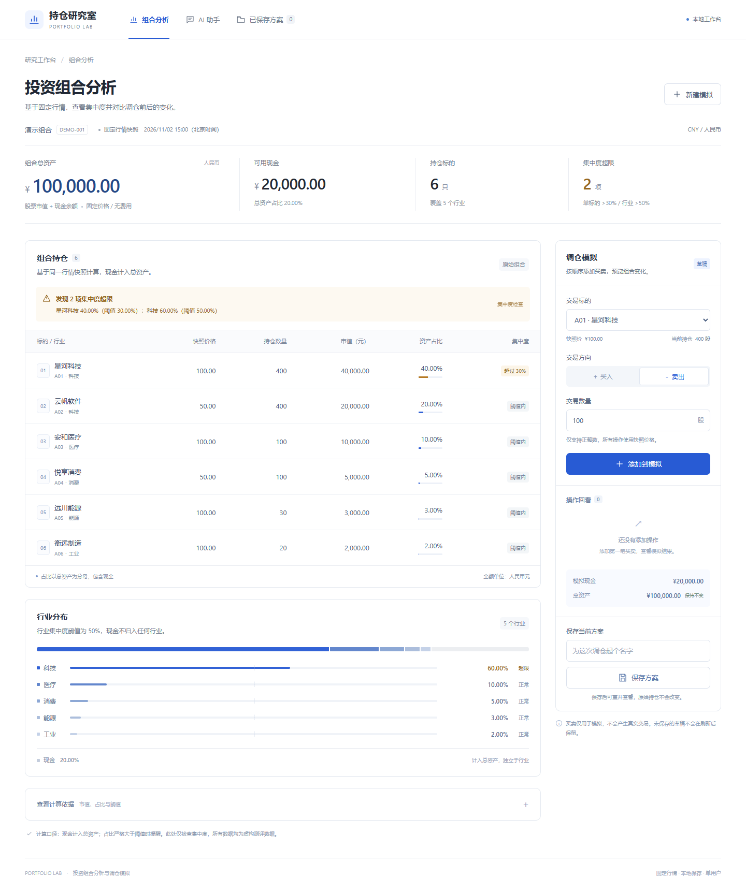
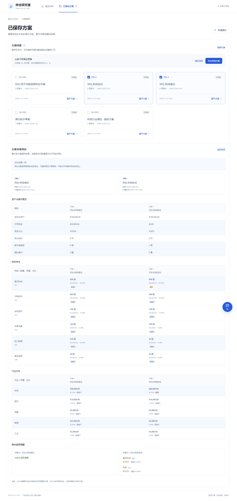
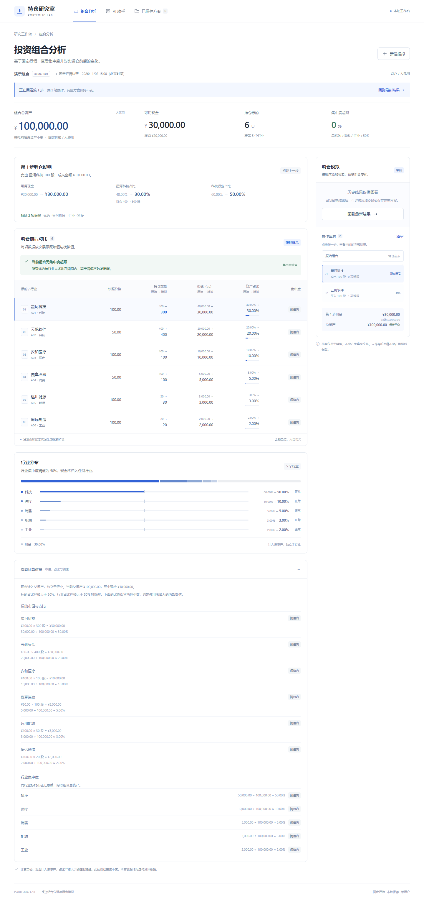
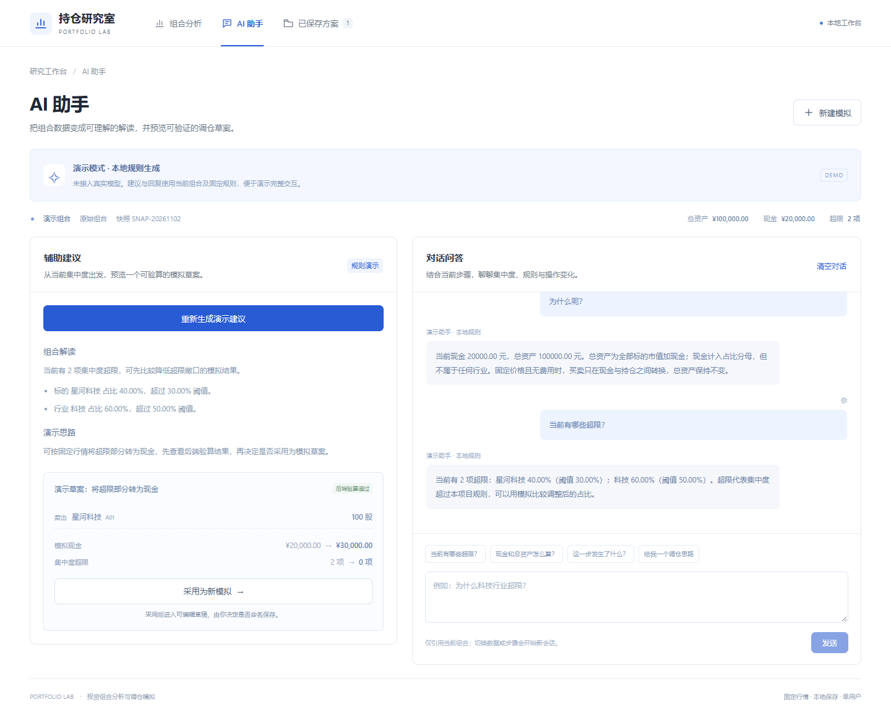

# 持仓研究室 · Portfolio Lab

基于固定行情快照的投资组合分析与调仓模拟。完成 VC-FIN-001 / V3.0 的“查看组合 → 超限识别 → 顺序模拟 → 前后对比 → 保存与重开”。单用户、本地运行，人民币计价。



## 环境与启动

已验证：Windows、Node.js **24.15.0**、npm **11.12.1**、Chrome **157.0.8103.39**（早期版本也在Chrome156验证）。要求 Node.js >=24.15.0（后端使用内置 `node:sqlite`）。无需安装独立数据库、申请 API Key 或设置环境密钥。

在解压后的项目根目录打开终端：

```powershell
npm ci
npm run build
npm start
```

打开 **http://127.0.0.1:3000**。停止服务按 `Ctrl+C`。第一次启动会自动创建 `.runtime/plans.sqlite` 并初始化方案表；原始数据直接读取 `data/portfolio.json`，无须另执行导入命令。页面不需要联网读取字体、图片或行情，安装依赖时需要访问 npm 仓库。

如 3000 端口已占用，在 PowerShell 中执行：

```powershell
$env:PORT = '3001'
npm start
```

访问地址相应改为 http://127.0.0.1:3001。服务仅监听本机 127.0.0.1。

## 演示与方案重开

1. 初始总资产 **100,000.00**，现金 **20,000.00**；A01 占 **40.00%**，科技行业占 **60.00%**，出现两项集中度提醒。
2. 在调仓模拟中选择 **A01 · 星河科技 → 卖出 → 100 股 → 添加到模拟**。现金变成 **30,000.00**；A01 **30.00%**、科技 **50.00%**，提醒均解除。
3. 再选择 **A02 · 云帆软件 → 买入 → 100 股 → 添加到模拟**。现金变成 **25,000.00**，A02 **500 股**，科技 **55.00%**，行业提醒再次出现。
4. 输入方案名称，点击 **保存方案**。页面进入已保存只读状态。
5. 刷新页面，进入顶部 **已保存方案**，点击相应方案的 **重开方案**；也可停止并重新 `npm start` 后再按此步骤重开。
6. 点击 **新建模拟** 回到原始组合；原始现金仍为 **20,000.00**、A01/A02 均为 **400 股**。

未保存草稿仅存在当前页面内存中；刷新不承诺恢复，页面提供离开提醒。已保存方案仅查看，不提供编辑或删除。每个方案最多 100 笔操作；方案名去首尾空格后 1～60 个字符，允许重名，以唯一 ID 区分。空操作方案也可保存。

## 两份方案并排对比

1. 进入顶部“已保存方案”，在两张方案卡片上勾选“加入对比”；按勾选顺序标记A、B，选满后其他复选框暂时禁用。
2. 点击“对比所选方案”，并排查看总资产、现金、持仓数、操作数、标的数量/市值/占比、行业分布和具体超限提醒。浅蓝色标记不同的数值或状态。
3. 每份结果由后端按其保存快照重新计算。页面标明两份快照及行情时间；快照完整内容不同时提示核对初始数据和规则，不能将差异全部归因于调仓。
4. “返回选择”保留已勾选项；取消一项后可以换选，或“清空选择”重新开始。读取失败会保留选择，恢复连接后可重试。

对比是只读操作，不修改已保存方案或当前未保存模拟；原有重开方案的放弃草稿确认仍有效。对比选择和结果不持久化，切换页面或刷新后重新选择。窄屏可在各张表格内部横向滚动。



## 看懂并回看每一步

- 每次成功添加操作，主区显示“第 N 步调仓影响”：现金、交易标的及行业占比相对于前一步的变化，以及新增或解除的提醒。
- 右侧“操作回看”可点击原始组合或任一步。资产摘要、持仓表、行业分布、提醒及计算依据同步切换；完整操作列表不会被裁剪。
- 回看历史时页面明确标记，仅供查看。点击“回到最新结果”后再继续交易或保存，新增交易仍从完整最新状态出发。
- “查看计算依据”默认折叠，展开可核对市值、占比分母、现金规则与严格阈值。比例展示值经过四舍五入，提醒判定使用后端未舍入数值。
- 保存方案仍只持久化原始快照和操作；重开时后端重新生成每步结果。既有方案无需迁移数据库。



## AI 助手演示

点击页面右下角的蓝色 **AI 圆按钮**，从右侧展开助手面板，可切换“对话问答”和“辅助建议”。关闭按钮、Esc 或点击面板外侧可收起。本版明确标识 **演示模式 · 本地规则生成，未接入真实模型**。无需 API Key、联网或模型服务，不产生模型调用费用。

1. 点击“生成演示建议”，读取当前组合/回看步骤的后端分析；原始组合会生成卖 A01 100 股的演示草案，并显示验算后的现金 30000、超限0项。
2. 草案只演示把集中度超限部分转为现金。先处理单标的超限，再按行业内当前市值较大者处理行业超限；不做收益预测，也不宣称这是最优投资策略。
3. 点击“采用为新模拟”进入可编辑草稿，之后按原有方式命名保存。不会自动保存或修改已保存方案；历史步骤会替换未保存后续操作时先确认。
4. 点击快捷问题或输入问题，支持集中度、现金、阈值、步骤变化和调仓思路。可继续追问，例如先问“现金和总资产怎么算”，再问“为什么呢”。这是一组限定主题的规则回复，不是通用大模型聊天。
5. 同一上下文收起再展开或切换导航，会保留对话、建议及未发送输入；改变操作、步骤或保存方案后开始新会话，避免旧上下文混用。采用建议后自动收起面板，回到模拟结果。聊天不持久化，刷新后清空。



## 开发与验证

```powershell
npm run dev
```

开发页面为 http://127.0.0.1:5173；API 为 http://127.0.0.1:3000。Vite 将 `/api` 代理给后端。`npm start` 使用构建产物，所以修改代码后需重新构建，或使用开发模式。

```powershell
npm test                 # 领域规则、真实 HTTP/SQLite 集成及 SSR 页面测试
npm run build            # TypeScript 检查 + 前后端生产构建
npm run verify:browser   # 独立 Chrome 会话，完整 UI 验收、真实重启、重建截图
npm run package          # 生成 output/portfolio-lab-submission.zip
```

浏览器验收要求本机安装 Chrome，使用独立临时数据库和端口 **3117**，不会修改日常使用的 `.runtime/plans.sqlite`。需要改用已安装的 Edge 时：

```powershell
$env:BROWSER_CHANNEL = 'msedge'
npm run verify:browser
```

其他系统可用 `BROWSER_CHANNEL=msedge npm run verify:browser`。本次实际验收平台为 Windows；其他操作系统未实测。验收脚本会更新 `docs/screenshots/` 和 `docs/browser-verification.json`。它模拟网络失败属于预期测试场景。

## 项目结构

```text
client/           React 中文工作台、交互状态及样式
server/           领域计算、Express API、SQLite 方案存储
shared/           请求结果的共享类型
data/portfolio.json  原始附件数据，作为只读输入
tests/            Node.js 自动化测试
scripts/          浏览器验收与提交打包
docs/screenshots/ 实际验收截图
PLAN.md           实现前原始方案（首次本地 Git 提交保留）
DESIGN.md         最终设计、取舍、复盘和 AI 协作摘要
VERIFY.md         验收步骤、结果与证据
docs/DEMO.md      演示流程与技术讲解提示
```

数据库保存在 `.runtime/`，已被 Git 和提交打包脚本排除。重启恢复依赖保留该目录，迁移到另一台电脑时可单独备份数据库；源码包从空方案库开始。`PORTFOLIO_DB` 环境变量可指定数据库路径。请在项目根目录运行命令。

## API 摘要

| 方法 | 路径 | 用途 |
|---|---|---|
| GET | `/api/portfolio` | 原始组合、快照、估值和提醒 |
| POST | `/api/simulate` | `{operations}`，从原始组合按顺序重放 |
| POST | `/api/plans` | `{name, operations}`，重新校验后保存 |
| GET | `/api/plans` | 已保存方案列表 |
| GET | `/api/plans/:id` | 用保存时的快照重算方案 |
| POST | `/api/assistant/advice` | `{context}` → 明确标识demo的组合解读和验算草案 |
| POST | `/api/assistant/chat` | `{context, question, history}` → 本地规则回复 |

操作示例：`{"symbol":"A01","side":"sell","quantity":100}`。金额返回十进制字符串，数量为整数，百分比显示两位小数，是否超限以后端结果为准。错误统一为 `{error:{code,message,operationIndex?}}`，操作索引从 0 开始。

模拟与方案详情额外返回 `steps`：每步含 1 开始的 `index`、`operation`、该步 `analysis` 和结构化 `impact`（交易金额、现金/标的/行业前后值、`resolvedAlerts`、`triggeredAlerts`）。`simulated` 始终是最终结果，回看选择只存在前端。

助手context为 `{operations, stepIndex, planId?, sourcePlanId?}`。planId表示查看已保存方案，使用其快照及操作；sourcePlanId表示从保存方案派生的草稿，仅使用其可信快照，并重放当前操作；两者互斥。由保存方案采用的草案会保留来源，后续 `/api/simulate` 和 `/api/plans` 也携带 sourcePlanId，保证预览、继续交易和保存一致。后端忽略前端伪造估值。

question上限1000字符，history最多6条user/assistant消息，每条1000字符以内；可选topic为受验证的话题枚举，用于延续超出历史窗口的简短追问，不包含余额等事实。返回 `mode: "demo"`，不包含真实模型调用。后续接真实模型时可替换规则生成部分，保留上下文重算、草案校验和用户采用流程。

## 提交说明

交付材料含源码、锁文件、初始化数据、设计材料、AI 协作记录、验证记录和截图。实际投入时间与未完成项见 [VERIFY.md](VERIFY.md)，演示讲解见 [docs/DEMO.md](docs/DEMO.md)。提交渠道和截止时间以招聘方通知为准。
